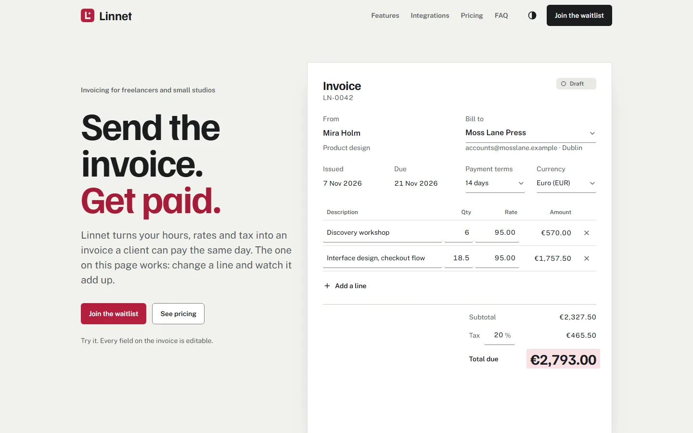
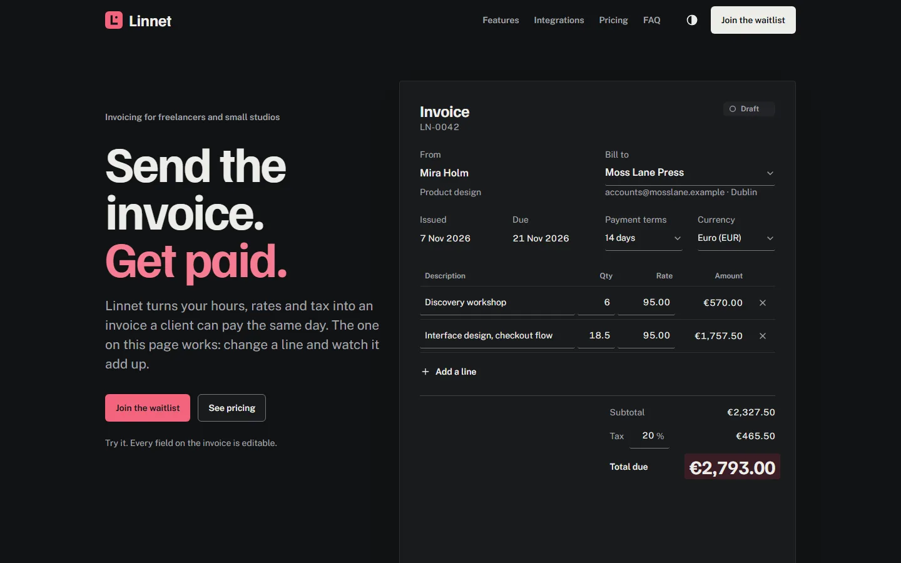
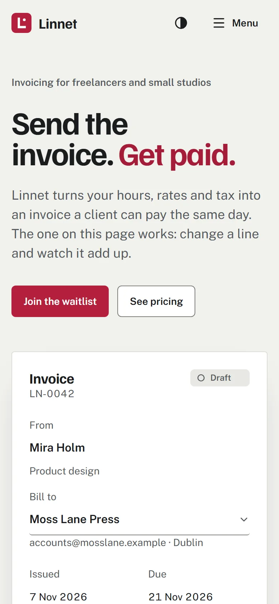
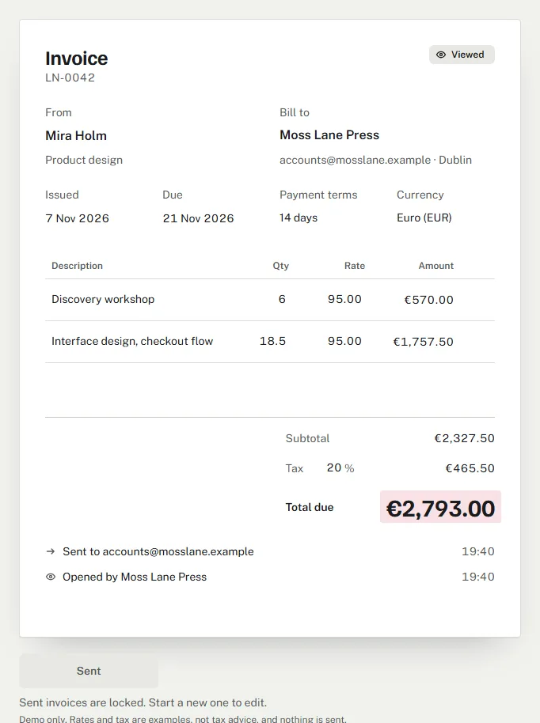

# Linnet

**Concept · self-initiated**

Linnet is a launch page for a fictional invoicing product for freelancers and small software studios. [Abubakr Alsheikh](https://abubakr-alsheikh.netlify.app) designed and built it as a portfolio piece: the page a SaaS founder could put in front of customers, written so an engineer enjoys reading the code.

**Live:** [linnet-app.netlify.app](https://linnet-app.netlify.app)



| Dark theme | Phone, 390 px | The demo mid-send |
| --- | --- | --- |
|  |  |  |

## What you can do on the page

- **Use the invoice in the hero.** Change a quantity, a rate, the client, the currency, the payment terms or the tax rate, and the totals add up in place, digit by digit. Add up to six lines, remove down to one. Press Send and the invoice moves from Draft to Sent, Viewed and Paid in 2.4 seconds, then takes a PAID stamp.
- **Watch six features explain themselves.** Each card carries a small diagram that plays once when it scrolls into view, and replays on request.
- **Switch pricing between monthly and yearly.** The prices roll to the yearly figures and the saving appears.
- **Read the FAQ, then join the waitlist.** The form posts to Netlify Forms, with or without JavaScript.

Everything works by keyboard, in light and dark themes, with reduced motion, from 360 px to 1920 px.

## What is real and what is fictional

Linnet, its company, its customers, their quotes and its prices are invented. The page says so in the footer, beside the quotes, under the prices and in the first FAQ answer. The integrations are categories with original icons, not partners, and no real brand appears anywhere. The invoice demo works but sends nothing. The waitlist form is real: submissions reach the author's Netlify Forms inbox.

## How it is built

[Next.js 16](https://nextjs.org) (App Router, Turbopack, Cache Components), React 19, TypeScript in strict mode, Tailwind CSS 4 and [shadcn/ui](https://ui.shadcn.com). The page is one static route.

**Content in MDX, checked by Zod.** Every sentence, label and message lives in `src/content/`. Each file's prose is its MDX body; its short fields (titles, labels, prices, error messages) are a `meta` export, typed `unknown` and parsed by a strict Zod schema in `src/lib/content/schemas.ts` before any component reads it. A missing field, an unknown key, or a field with an em dash, an exclamation mark or a character outside the fonts' Latin subset fails the build and names the file. Components hold no copy. Tests tie the content to the code: the demo's default invoice totals €2,793.00, the advertised yearly saving matches the prices, every waitlist field exists in the Netlify form declaration.

**Invoice maths in integers.** `src/lib/invoice/calc.ts` works in minor units: quantities in hundredths, money in cents, tax in basis points, rounding half away from zero. Six lines at the maximum with 30% tax stay safe integers. A pure reducer (`demo-machine.ts`) owns the demo's states and the send timeline; the parser reads "18.5", "18,5", "1,572.50" and "1.572,50".

**Components.** The primitives in `src/components/ui/` are shadcn/ui on Radix, restyled to the design tokens in `src/app/globals.css`. Where a native element serves people better, the page uses it: native selects in the demo and the form (a Radix Select hides the rest of the page from screen readers while it is open), native radios for the billing switch and the team choice (one Tab stop, arrow keys, and a form post that works without JavaScript). The theme menu, the mobile navigation and the FAQ accordion render plain markup and load Radix on first use.

**Only the interactive leaves run on the client:** the invoice demo, the diagram frame, the billing switch, the theme menu, the mobile navigation, the FAQ accordion and the waitlist form. The rest renders on the server.

**Motion with a purpose.** Every animation starts from something the visitor does, or a diagram scrolling into view, and then stops. Nothing loops. [Motion](https://motion.dev) drives the demo and the pricing digits; the feature diagrams run on CSS transitions over server-rendered final frames, so they ship no JavaScript. Durations live in `src/lib/motion.ts`, mirrored as CSS custom properties, and a test keeps the two equal. Under `prefers-reduced-motion` every state still appears, without movement.

**The waitlist on Netlify Forms.** The form is declared in `public/__forms.html`, where Netlify finds it at deploy time; the React form posts there by `fetch`, or natively without JavaScript. Zod loads on the first focus inside the form, not with the page.

## Measured results

Measured on the production build on 7 November 2026.

| Check | Result |
| --- | --- |
| Tests (Vitest) | 145 in 13 files |
| Lighthouse mobile, HTTP/2, median of 5 | 99 performance, 100 accessibility, 100 best practices, 100 SEO |
| Lighthouse desktop, median of 3 | 100, 100, 100, 100 |
| Largest Contentful Paint (mobile, simulated) | 1.05 s |
| Cumulative Layout Shift | 0, on load and through the demo's send sequence |
| axe-core | 0 violations in both themes at 360, 768 and 1280 px |
| First-load JavaScript | 240 KB gzip |
| Widths checked | 360, 768, 1024, 1280, 1440 and 1920 px, both themes |

## Run it

Node 24 (`.nvmrc`).

```bash
npm install
npm run dev         # local dev server
npm run build       # production build
npm start           # serve the production build
npm run lint        # ESLint
npm run typecheck   # tsc --noEmit
npm test            # Vitest
npm run contrast    # WCAG contrast of every colour pair, both themes
npm run screens -- http://localhost:3000 screenshots 360,768,1280,1920        # full-page screenshots
npm run screens -- http://localhost:3000 screenshots/dark 360,1280 dark       # the same in dark mode
npm run axe -- http://localhost:3000 360,1280                                 # axe-core scan
```

The screenshot and axe scripts drive a local Chrome over the DevTools Protocol, with no extra dependencies.

## Project layout

```
src/
  app/            the page, layout, share image, icons, manifest, 404
  content/        every word on the page, as MDX
  components/     layout, sections, demo, diagrams, pricing, faq, waitlist, icons, ui
  lib/            content schemas, invoice maths, pricing, waitlist, motion presets, theme
public/__forms.html   the waitlist declaration for Netlify Forms
scripts/          contrast, screenshots, axe and an HTTP/2 proxy for Lighthouse
```

## Credits

Familjen Grotesk and Public Sans are licensed under the SIL Open Font License 1.1; the share image uses static copies in `assets/og/`, with their licence files. The interface icons come from [Lucide](https://lucide.dev). The integration icons and the feature diagrams were drawn for this page.

## Author

Designed and built by [Abubakr Alsheikh](https://abubakr-alsheikh.netlify.app). MIT licence.
